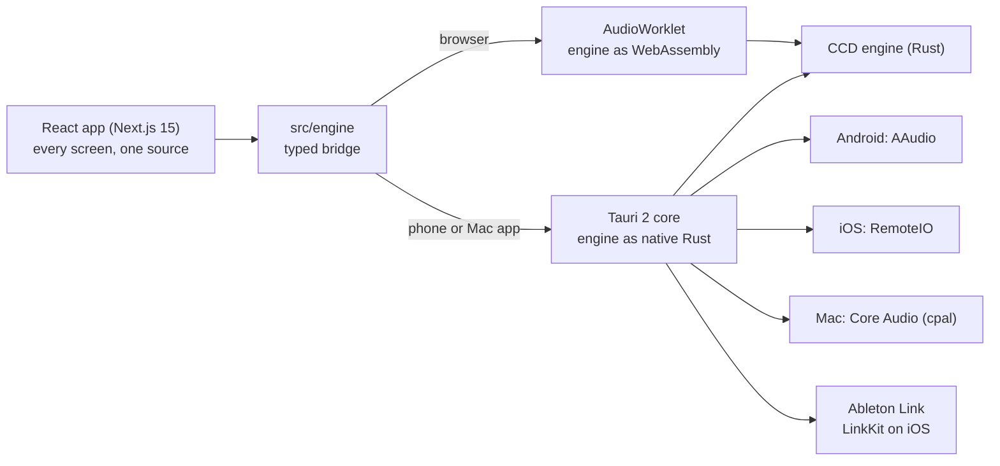

# CCD School

Learn music by making it. CCD School is a music instrument and a school in one app: you learn an idea, play it on a real instrument with real sound, it becomes part of your own track, and that track opens in Ableton Live. One Rust sound engine and one React app run on the web, iPhone and Android. Part of Cats Can Dance (catscandance.com), Bengaluru.

Last updated 5 Nov 2026 (after improvement checks 1 to 3). Branch `school/field`, preview at ccd-school-app-git-school-field-washedupdegen-8712s-projects.vercel.app. This file describes the whole product: what it does, why it is built this way, what the technology can do, what is missing, and what to improve next.

---

## Contents
1. [Status at a glance](#1-status-at-a-glance)
2. [Who it is for](#2-who-it-is-for)
3. [Why this can be the best music learning and making tool](#3-why-this-can-be-the-best-music-learning-and-making-tool)
4. [Features](#4-features)
5. [Design](#5-design)
6. [Decisions and why we made them](#6-decisions-and-why-we-made-them)
7. [Technical capabilities](#7-technical-capabilities)
8. [Gaps, honestly](#8-gaps-honestly)
9. [Improvements we recommend](#9-improvements-we-recommend)
10. [Roadmap](#10-roadmap)
11. [Repo map and how to run it](#11-repo-map-and-how-to-run-it)
12. [Where the detail lives](#12-where-the-detail-lives)

---

## 1. Status at a glance

| Area | State |
|---|---|
| Lessons | All 198 lessons are in the new player and act on your song: 57 song lessons (the spine, one song built across basics, producer and dj), 133 optional deeper lessons hung off them, 8 bonus rounds, placed from `ccd/school-curriculum.md` (nothing from the old 171 lost). Real controls behind them (5 Nov): an lfo, an fm operator and a separate filter envelope on the synths, an arpeggiator, key shift, a note grid with all twelve notes and velocity, a sampler step (hits, mic recording, your own files, slicing, warping), take lanes and comping, macros with saved variations, and dj decks with sync, hot cues, loops, stems, key shift, crossfader curves, your own file on either deck and record your mix. Every lesson walks start to done on desktop Chromium and phone WebKit, and every mixer goal passes, by script. Three improvement checks by fresh reviewers (5 Nov) fixed 41 issues: lessons that change the song keep the change, phone instruments clear the go bar, play-in counts presses and names its part, keyboard play everywhere, pink only on the go key, knob values shown, the recorded take as a ghost lane, arrangement blocks under the song, a two-column desktop onboarding. Status and fixes: `ccd/school-fixes.md` (items 76 to 116), `ccd/school-curriculum.md`. An automatic improvement loop runs on the branch five times a day (`design/loop/`). By ear (8 Nov, after studying Syntorial and Building Blocks, `design/audible-genius.md`): 15 lessons have a copy-by-ear step (write a hidden drum pattern, bass line, chords or melody on a grid, each note marked) and 18 have a match step with notched knobs and green and red marks. |
| Lessons (old) | The old 171-lesson player still exists for the sims and old routes; every lesson slug now opens in the new player. |
| Practice | Ear Gym (EQ, compression, groove, match this sound and copy by ear, the last two on the engine: Syntorial's notched knobs with green and red marks, and Building Blocks' write-it-by-ear grid) with adaptive difficulty and real recorded sounds, now in Model 1: skill levels on the glass, drill pads, a focused drill screen with a/b keys. Spaced review, daily practice, placement test. The drills still render on Web Audio until they move onto the engine (item 4). |
| Ableton bridge | Reads your own Live Set (`.als`): Build a Set (14 checked stages), Do it in Live (27 lesson tasks), Check my Set, Device Atlas (67 devices), Plugin Guide, Setup guide. |
| Sound engine | Built. Rust, sample-accurate, drum rack, bass, polyphonic chords, lead, fx and a 16-slot sampler; WebAssembly in the browser, native on phones. Engine 2 finished 5 Nov (all twelve items, plan and numbers in `ccd/school-engine-plan.md`), each with a measured test in `engine/tests/sound.rs`: anti-aliased drive, voice cards, 808-circuit hats, the JP-8000 supersaw, an 808 kick with three body shapes, a master chain with a BS.1770 loudness meter and -14 LUFS wav export, three filter circuits named as in Live's Auto Filter (prd, ms2, svf) with drive, drums as tone and noise layers, a smoother hall and a Dattorro plate, pluck / mallet / keys resonators, tape and analogue echo, wavetable / feedback fm / phase distortion. A full song costs 22.6% of one core. Instruments (5 Nov): envelope and filter pictures from the engine's maths, knobs coloured by what they move, velocity pads, hold a step to lock a knob, capture, phone note editing, fill and randomise, frequency-coloured dj waveforms, per-hit timing marks in play-ins. Taken from other DAWs and synths (5 Nov, `design/compare.md`): every control uses Live's name, with a "same control elsewhere" note (`design/naming.md`); drag the filter and envelope pictures; drag the lfo or filter env onto any knob, shown as a ring; a level-matched a/b key; a scope and a mix spectrum; match this sound; Live 12's 35 scales and a chord track; a drummer and a bass player (complexity, intensity, fill, swing); strum, humanize and velocity shape; chance and trig conditions per step; punch-in effects; commit; per-part length and swing. Hear it: `/sound`, 25 loudness-matched clips with a blind mode. Not yet ear-tested by Param. Leftovers built 6 Nov: lfos on drums, fx and the sampler, rings that move while playing, chance in the midi export, free-running part lengths, punch-ins recorded into the song, sample-exact p-locks. Sound shootout 6 Nov (`design/sound-shootout.md`): rendered against Surge XT, Vitalium, Odin 2, Dexed, Geonkick, Dragonfly and CHOW Tape on our own patches and measured the same way; where ours measured worse and could be fixed, it was: the hall now fills in 18 ms (was 65), saws use minBLEP (aliasing down about 30 dB, level with Vital's), the ladder's clip is anti-aliased. Still behind: mono synth voices and a shorter resonance range. Blind pairs on `/sound/compare` (not linked, noindex); no claims until Param's ear test. |
| Studio (the instrument) | Play mode built for all six layer types plus a sampler layer (step 3): steps at 1/8, 1/16 or 1/32 in one to four bar loops, keys, pads and each type's own surface (glide, circle, chord pads, xy, rolls, riser, sample load), sound presets, several saved songs, recording with count-in, overdub and undo. Mix mode (step 2) is built: stage, clash and fix, compare, faders. First visits land on a loop already playing. |
| Phone apps | Tauri 2 shell with native low-latency audio built. Android APK built (unofficial, sideloaded). iPhone build runs from Xcode on a Mac. Phone work paused until the web app is complete. |
| Ableton Link | In the phone and Mac apps (LinkKit on iOS, open-source Link on Android and Mac). Not yet tested against Live on a device. |
| New design (Model 1) | Every screen designed (44 boards). Built and checked at 390x844 light and dark in Chromium and WebKit: welcome, Today (two columns from 900 px), All lessons and worlds, Studio (play and mix, three columns from 900 px), DJ, footer, the lesson player and every step, practice and drills, you, library, sign in, menu, moments, device pages, daily, review, shop, leaderboard, placement, public profile, header, command palette, and the reference pages (setup, glossary, plug-ins, shortcuts, signal flow, wiki, devices, link, build, all lessons, challenge, upgrade layout, first beat). No emoji in the UI or lesson data. Still old: the path list, playground and match pages, the device lab and the 47 sims inside their frames, and the journeys after J1 (they describe the old UI). |
| Accounts and payments | Sign-in, saving, leaderboard proven on a Supabase database. Stripe and Razorpay wired, not live. Everything is free by default (decided 3 Nov); the admin switch can still turn paid lessons on. |
| Production | `learn.catscandance.com` still serves an older build. The new work is on branches, not merged. |

---

## 2. Who it is for

- **Total beginners.** Make a sound in seconds, finish a loop in the first session, learn the words as you need them.
- **People who have tried Ableton and stalled.** Placement skips what they know. Build a Set walks them through a whole track and checks it in their own Set.
- **Producers who want to get better.** Mixing missions, device and plug-in reference, ear training, and later a mix coach that reads real measurements.
- **DJs.** A full DJ world (40 lessons, rekordbox-based) and a DJ screen that will run on the same engine.
- **The CCD path.** Learners make real tracks, and the best get played at CCD nights. The PRD pilot: 20 learners in Bengaluru, first showcase in January 2027.

---

## 3. Why this can be the best music learning and making tool

### The gap
Tools that teach do not make music, and tools that make music do not teach.
- **Learning apps** (Melodics, Ableton's free Learning Music and Learning Synths, Syntorial) teach well, but you leave with drill scores or browser exercises, not a track. Melodics itself says it is not a DAW.
- **Making apps** (Koala Sampler, BandLab, GarageBand, FL Studio Mobile, Groovepad) make music, but leave the learning to YouTube. Some export to Live (Koala on iOS), but nothing checks whether you understood what you did.
- **DAWs** (Ableton Live and others) do everything and teach nothing. Most beginners quit in the first week.
- **Courses** in India cost a lot per month, and free tutorials give no feedback.

### What CCD School does differently
1. **Every lesson ends in your track.** A lesson teaches one idea, you play it on the instrument, and "use this line" makes it a layer of your track. You finish with music, not a score.
2. **A real instrument, not a toy.** The engine is built the way professional plugins are built: band-limited oscillators, oversampling, zero-delay-feedback filters, sample-accurate timing. The bar is to sound and play as well as top commercial instruments. That is a target we test against, not a claim yet (see Gaps).
3. **Checked in your own Ableton Set.** Upload your `.als` and the app reads it: tempo, tracks, devices (even inside racks), sends, sidechain, automation. Build a Set and Do it in Live tasks are checked against what you actually built. We know of no other learning tool that does this.
4. **Connected to Live.** MIDI export now; Link tempo sync in the apps; stems and Live Set export planned. Learn here, finish in Live.
5. **One app everywhere, low latency.** The same engine runs natively on phones (about 1 ms of engine latency on top of the audio hardware) and in any modern browser.
6. **Sourced, not invented.** Lesson facts are checked against the Live 12 manual, rekordbox documentation and Ableton's own learning sites. Claims we could not verify were removed or reworded.
7. **A stage at the end.** CCD runs real nights. Learner tracks can be played at CCD Episodes. No learning app has that.
8. **Built for India and the world.** Phone first, works on mid-range Android, payments in INR (Razorpay) and globally (Stripe).

### Market sources
- [10 best beatmaking apps in 2026 (Melodics blog)](https://melodics.com/blog/10-best-beatmaking-apps-in-2026): Melodics describes itself as a learning app and not a DAW; Koala Sampler exports Ableton Live Sets on iOS; BandLab and Soundtrap add AI mastering and collaboration.
- [Best beat making software 2026 (Tracklib)](https://www.tracklib.com/blog/best-beat-making-software-2026).
- This is a positioning read, not a full competitor study. Check it again before quoting it externally.

---

## 4. Features

### Learn
- **171 lessons in three worlds.** Fundamentals 40 (sound, rhythm, melody, harmony). DJ 40 (rekordbox: library, beatmatching, EQ mixing, harmonic mixing, effects, stems, set building, DVS, the business). Producer 91 (synthesis 18, plus Live: first contact, two views, MIDI and audio, devices, mixing, performance, MIDI instruments, Live 12 power).
- **Deep lessons (116 of 171).** A problem you can picture, the idea, something to move, scenario questions, exact settings, a "what went wrong" check, one recycled question, a summary. Quiz answers are shuffled per lesson and guarded by tests.
- **Two modes.** Flow (in order, with hearts) and Free (everything open, no hearts).
- **47 interactive sims** (synth, filter, envelope, drum pad, sidechain, EQ, mixer and more). They currently run on the browser's Web Audio; they move onto the CCD engine in build step 5.
- **Placement test**, a world-aware start point, and a dashboard ("your next moves") that changes with your level.
- **Retention:** FSRS spaced repetition, daily practice, XP, 12 ranks, streaks, leagues, daily challenge, leaderboard, gem shop.
- **Reference:** glossary, wiki, signal flow, device explainers, keyboard shortcuts.
- **Lesson hook (new design):** what you will learn, what it adds to your track, and the control you will use, named for the thing being learnt.

### Practice
- **Ear Gym** (`/gym`): EQ band, compression (on or off, then attack), tempo and groove. Difficulty goes up after 4 right in a row and down after 2 misses. A/B clips are loudness-matched and switch with no gap. Real recorded kick, clap, snare, hat and piano loop. 5-minute sessions, 3 a week with one free pass, no daily streak pressure.
- **Older ear training** (`/train`) and listening demos built from real recordings and clips rendered on the CCD engine.

### Make: Studio, the instrument
- **8 layers per track:** drums, hats, bass, chords, lead, fx. Drums and bass play on the CCD engine today; chords and lead play on the bass synth until their instruments land (step 3).
- **Ways to play:** steps (a lane per sound, 8 steps a page), keys (black keys between), pads (a 16-pad drum rack with a ripple on hit; bass on an A minor scale grid with roots lit). Each layer type gets its own fourth surface in step 3: glide strip, circle sequencer, chord pads, XY, rolls, riser.
- **Shape:** one knob bank switch per layer (sound, eq, fx, mix) with 4 knobs, plus mute and solo. Every layer carries its own mix: level, pan, send and duck.
- **Record:** a 1-bar count-in, play loops the take, rec again overdubs, snap to 1/16, 1/32 or off, one take is one undo step, notes land where your finger touched (touch time is compensated).
- **Export:** the track as a MIDI file for Live.
- **Track format v2:** up to 8 layers of note events. Older v1 tracks migrate automatically, and lessons keep working through a v1 view.

### Bridge to Ableton Live
- **Live Set reader:** reads `.als` files in memory, never stores or changes them. Tested on eight real Sets from Live 12.1 to 12.3.
- **Build a Set** (`/build`): 14 stages in the order a track comes together, from tempo to limiter, each checked in your Set, with XP once per stage.
- **Do it in Live:** 27 lessons end with a job in Live, checked when you upload your Set.
- **Check my Set** (`/link`): a readable summary plus four mixing missions.
- **Device Atlas** (`/atlas`, 67 stock devices with edition), **Plugin Guide** (`/plugins`, 13 jobs, stock first), **Setup** (`/setup`, 11 steps).
- **First Beat** (`/beat`): a 16-step beat maker with swing and MIDI export.
- **Ableton Link** in the phone and Mac apps: the engine follows the session's tempo and lands its loop on the session's bars.

### DJ
- 40 deep DJ lessons and a DJ screen. Both decks will run through engine strips, with your own track on deck A (step 6).

### Accounts, money, app
- Sign-in (email and password, Google optional) with NextAuth; progress saved to Postgres on Supabase (India region) behind a limited database role.
- Free and Pro gating (first 3 lessons of each path free), switchable by admin.
- Stripe (global) and Razorpay (India, UPI) subscriptions, signature-checked webhooks.
- PWA with offline service worker, web push streak reminders, AI beat coach (static fallback without a key), analytics events.

---

## 5. Design

**Model 1, approved 3 Nov 2026.** One family of hardware-style instruments with a single look across learn, studio, DJ, practice and profile.
- Screens are deep glass with an engraved seam; pads sit in one recessed tray, matte silicone.
- Light means something: the selected pad lights from behind; a dim glow only points at something (today's pick, the playing step, root notes). Knobs and faders stay clean, with no light rings or meters on them.
- Labels are engraved, copy is plain and lowercase in the UI, every screen is full height, light and dark both designed.
- 44 final boards cover learn, lesson steps, studio for all 6 layer types and their surfaces, mix (stage, clash and fix, compare, faders), light studio, DJ, practice, library, you, first run, sign in, menu, moments and tablet.
- Design canvas: https://claude.ai/code/artifact/36c4ce2a-9660-4375-a101-a41ac0edc49a. Sources and screenshots: `artifacts/ccd-school/design/`.

---

## 6. Decisions and why we made them

| Decision | Why | What we turned down |
|---|---|---|
| **One Rust sound engine for every platform** | Same sound and timing on web, iPhone and Android. Rust gives C-level speed with no garbage collector, safe real-time code (no allocation or locks in the audio callback) and compiles to both native and WebAssembly. | Separate engines per platform (they drift); Web Audio nodes only (not sample-accurate, varies by browser, no oversampling). |
| **Build the DSP ourselves, the way pro plugins do** | Quality comes from the maths: band-limited oscillators, 2x oversampling around anything nonlinear, zero-delay-feedback filters, a resolved ladder filter. Study references: Surge XT and Vital (GPL, study only), Airwindows (MIT), chowdsp. | Shipping GPL synth code (would force the whole app open); a black-box third-party engine. |
| **Fixed 1 ms engine latency, cancelled by the sequencer** | Oversampling filters add delay. Keeping it fixed and running the sequencer ahead by the same amount (like DAW delay compensation) means sequenced notes land exactly on the beat. Played notes are placed at the moment the finger touched. | Variable latency per path (timing jitter, which was measured and fixed). |
| **WebAssembly in an AudioWorklet on the web** | Runs the real engine on the browser's audio thread at full speed. One 112 KB file. | Main-thread audio (glitches under load). |
| **Tauri 2 for the phone apps, not Capacitor** | The app core is Rust, so the engine runs in the same process with no Swift or Kotlin bridge. Android uses AAudio low-latency exclusive mode; iOS uses RemoteIO with a 64-frame buffer. | Capacitor (a JavaScript bridge in the audio path); fully native apps (three codebases). |
| **The web app is the one source of every screen** | Phones open the web app; only sound is native. Anything finished on the web is finished on phones. Content changes ship without app store reviews. | Separate phone screens that fall behind. |
| **Web first, phones paused** | The app is not finished, and phone work also waits on outside steps (Apple enrolment, Ableton's licence reply). Finishing the one source first is the fastest path to everything. | Building phone polish on unfinished screens. |
| **LinkKit on iOS, open-source Link on Android (unofficial APK)** | LinkKit is Ableton's free iOS SDK and allowed in the App Store. Open-source Link is GPL, fine for test builds. Ableton's proprietary Link licence is signed (Param, 5 Nov), so Link can ship in a Play Store app; the Android store build is still to do. | Shipping GPL code in a store app; dropping Link. |
| **No Link inside the browser** | Browsers cannot send the network traffic Link uses. Browser sync will use MIDI clock from Live (Chrome, Edge); real Link lives in the Mac and phone apps. | A helper app every web user must install. |
| **Generated parameter types** | Parameter names, ranges and curves are defined once in Rust and generated into TypeScript. A test fails if they drift. | Hand-kept lists in two languages. |
| **Track v2 with a v1 view** | Studio needed note events and 8 layers; lessons, Today and DJ use the old shape. A bridge let us change the format without breaking 171 lessons. | A big-bang rewrite of every consumer. |
| **Synthesised drums for now, samples later** | Synthesis needs no licences and sounds clean. Real kits need recording or licensing: an open decision (commission CCD kits, license a library, or both). | Unlicensed samples. |
| **Lessons sourced from official manuals** | Trust. Every Live and rekordbox claim was checked; unverifiable ones were removed. | Plausible but unchecked copy. |
| **Read the learner's Live Set, never store it** | Proof of real work in real Live, with privacy: the file is read in memory and dropped. | Quiz-only progress; uploading user projects to a server. |
| **Standalone app at learn.catscandance.com, linked to CCD** | Least work before the pilot; moving into the CCD platform stays possible after it (PRD option c). | Merging into the CCD site now. |
| **Both payment rails** | A global product with an Indian home: Razorpay for UPI and INR, Stripe for the rest. | One provider. |
| **No AI composing graded work** | The point is that learners make the music. AI helps where it teaches (a few measured listening clips, a coach), never instead of the learner. | Generated tracks passed off as learner work. |
| **Measure, then listen** | Every sound claim is measured (spectra, aliasing, timing, CPU). Final quality calls need human ears and blind A/B against Live. | Calling it pro-grade before anyone has listened. |

---

## 7. Technical capabilities

### Architecture


### The engine (`engine/`)
- **Clock and sequencer:** sample-accurate; per-sample loop position; count-in; plays ahead by its own latency so the beat is exact; follows Link tempo and bar position when Link is on.
- **Commands in, events out:** lock-free single-producer rings (8,192 commands, 4,096 events); no allocation in the audio callback; one C interface shared by WebAssembly and native builds.
- **Instruments:** 16-pad synthesised drum rack (kick, snare, clap, rim, hats with choke, shaker, ride, three toms, crash, two percs, fx, reverse) with tune, decay, drive and level per pad; mono bass synth with PolyBLEP saw and pulse at 2x oversampling, sub, drift, legato glide, ADSR and a 4-pole ladder with resolved feedback and soft clipping.
- **Channel strip per layer:** low and high shelves, mid bell, cut filter (zero-delay-feedback designs), oversampled drive with latency-matched bypass, bit crush, tone, echo send, duck (sidechain), equal-power pan, fader with 0 dB at 75%.
- **Returns:** 8-line FDN reverb (Hadamard), ping-pong echo.
- **Oversampling:** 49-tap Blackman-Harris half-band filters, whole-sample latency, constant across every path.
- **Measured:** about 1.8 ms from touch to engine in the browser; a touch-to-sound estimate of about 14 ms in headless Chrome (128-frame buffer). Worst case of 8 busy layers on the cloud test machine: about 16% of one core native and about 21% as WebAssembly.
- **Tests:** 36 Rust tests, including timing at any buffer size, a note placed at touch time, count-in, duck depth and heavy load. An offline `render` tool plays MIDI through the engine for A/B comparisons.

### The web app (`artifacts/ccd-school/`)
- Next.js 15 (App Router), React 19, TypeScript, Tailwind v4.
- Postgres on Supabase via `pg`, NextAuth v5, Stripe, Razorpay, PostHog, Vercel.
- 20 test files with about 199 unit tests (theory, timing, schema migration, the Live Set parser, checks, gym, payments), plus browser scripts: journeys (10 journeys, 93 checks), smoke (every page on phone and laptop), a full lesson crawl and accessibility checks. Journeys and smoke run in Chromium, WebKit and Firefox.

### The phone and Mac shell (`mobile/`)
- Tauri 2. Opens the deployed web app; the native engine starts on the first touch.
- Android: AAudio low-latency exclusive stream, two-burst buffer, multicast lock for Link, screen kept on.
- iOS: RemoteIO with a 64-frame buffer request, playback session, LinkKit settings screen.
- Reports platform, sample rate, buffer, output latency and CPU load to the engine lab (`/lab/engine`), which includes a microphone latency test.

---

## 8. Gaps, honestly

**Sound and feel**
- Nobody has listened critically yet. Every sound check so far is a measurement. Blind A/B against Live's instruments has not been done, so "as good as the best" is a target, not a result.
- The chord synth is mono (no stereo width yet) and there is no multisampled kit or wavetable oscillator yet (engine 2, item 12). The sampler plays your own files, mic recordings and the recorded kit; there are no CCD kits beyond that yet.
- No velocity from how hard you hit, no pressure, no MPE, no MIDI controller input yet.

**Studio**
- Lead filter motion and the riser fader are live only (not recorded). Samples are kept in the browser and do not reach the phone shell yet.
- Export is MIDI only. Stems and a Live Set (`.als`) export are not built.

**Lessons and app**
- The lesson player, practice, library and profile are in the new look. The 47 sims and the Ear Gym still play through the browser's Web Audio, not the engine (item 4). The path list, playground and match pages, and the device lab are still old.
- 55 of 171 lessons are still in the short format.
- Teaching quality has not been play-tested with beginners. A few rekordbox details and some Live shortcut claims are still unverified.
- Accessibility: about 11 contrast issues remain on world pages. Audio drills need full keyboard and screen-reader paths.
- English only.

**Platforms and Live**
- Real latency on iPhone and Android is not measured, and Link has not been tested against Live on a device.
- Link on iPhone needs Apple's multicast permission, which only a paid Apple Developer Program account can request. The account is not enrolled yet.
- Android Link: Ableton's proprietary licence is signed (5 Nov). Next: a Play Store build, and swapping the GPL Link build for the licensed one.
- Browser tempo sync (MIDI clock) is not built.

**Product and launch**
- The new work is not merged; production still serves an older build on an older hosting project.
- Missing keys: admin password, Google sign-in, payment keys, push email.
- PRD features not built: track uploads with versions and comments, crews, listening room, peer reviews, mentors, showcase submissions.
- Privacy items from the PRD (India DPDP: itemised consent, export and deletion, grievance contact) are not built.
- The three AI clips are gone: the listening clips are now rendered on our own engine (measured, not yet listened to critically).

---

## 9. Improvements we recommend

Ordered by impact for the effort. All of these were adopted into the plan on 3 Nov 2026 (`artifacts/ccd-school/design/instrument-plan.md`, "Web first"); the roadmap below shows where each one lands.

1. **Sound in ten seconds.** Open first-time visitors straight onto the pads with a loop already playing, then teach. The PRD goal is sound in under a minute; we can beat it by a lot, and it is the best demo we have.
2. **Make the track the spine of the course.** Every lesson's "use this line" adds a layer; every world ends with a finished, exportable track. Progress becomes "your tracks", not only XP.
3. **A listening panel before any quality claim.** Five producers, blind A/B of our drums, bass and mix against Live's instruments on the same MIDI, scored per sound. Publish a short sound report. Fix what loses.
4. **Record a CCD kit with the residents.** It settles the sound-sources decision, gives the app a sound nobody else has, and is great content for the 150k-follower page.
5. **A mix coach built on measurements.** The engine's meters and clash detection can say exactly what is wrong ("bass and kick fight at 60 Hz, try the duck"). It is more trustworthy than a language model guessing, and it teaches.
6. **Web MIDI in, MIDI clock in.** Chrome and Edge support both. Controllers and Live sync on the web for little work.
7. **One audio path for everything.** Move the 47 sims and the Ear Gym onto the engine early, so "boosted" and "compressed" sound the same everywhere.
8. **The CCD stage as the reward.** Build the showcase loop from the PRD (submit, crew review, picks played at Episodes), and put picked learners on the CCD artist pages. This is our unfair advantage.
9. **Hindi copy and low-end phone mode.** A smaller audio buffer option, a battery saver, and Hindi lessons widen the audience in India.
10. **Clean house.** Retire the duplicate older pages (`/train` versus `/gym`, the old lesson screens once the new player lands), close the missing keys, merge, and move `learn.catscandance.com` to the new project.
11. **Decide the price.** What is free, what is Pro, and whether the pilot is free (the PRD says yes).

---

## 10. Roadmap

Web first. Each step ends with tests passing and every touched screen checked at 390x844 in light and dark, in Chromium and WebKit.

1. **Mix (done 3 Nov):** master glue compressor and true-peak limiter, metering and analysis, clash detection, compare, lower-latency oversampling; mix mode in Studio.
2. **All 6 layer types (done 3 Nov):** polyphonic chords, lead, hats and fx instruments, a sampler voice, every fourth surface; sound in ten seconds for first-time visitors. Built, with a sample layer for the sampler.
3. **Getting music out:** MIDI, stems and Live Set export; Web MIDI controllers and MIDI clock sync in the browser.
4. **Lessons on the engine:** the new lesson player, try-it recording, add to track, unlocks; sims and Ear Gym move onto the engine; your track as the spine of every world; the mix coach; the 55 short lessons deepened.
5. **Every other screen:** Today, World, practice, library, profile, onboarding, sign in, menu, moments, DJ, light studio, tablet and desktop, PWA; the CCD showcase loop; privacy (DPDP).
6. **Final pass:** copy, accessibility, performance (8 layers on a mid-range phone browser), low-end phone mode, Hindi, full test runs, clean house, merge and domain move.

Param's answers (3 Nov): sounds from our own synthesis and open recordings, the way Vital does it; no listening panel yet; everything free for now with a Pro proposal in `ccd/school-pro.md`; keys later; the AI clips are replaced.

7. **Then the phones:** Apple enrolment and the multicast request, device latency and Link tests, TestFlight and an Android release.

---

## 11. Repo map and how to run it

```
engine/          Rust sound engine (DSP, instruments, sequencer, C interface, tests, render and type tools)
engine-wasm/     WebAssembly build of the engine
mobile/          Tauri 2 shell for iOS, Android and Mac (native audio, Ableton Link)
artifacts/ccd-school/
  app/           routes (learn, studio, gym, build, link, atlas, dj, lab/engine and more)
  src/engine/    typed bridge: browser (WebAssembly) and app (native) hosts, generated params
  src/lib/       track v2, recorder, theory, Live Set reader, progress, payments
  src/content/   lessons, Atlas, Build stages, Live tasks, glossary
  design/        Model 1 boards, screenshots, plan, build notes, next-chat prompt
  tests/         unit tests
  scripts/       journeys, smoke, lesson crawl, accessibility, screenshots
```

**Web app**
```bash
cd artifacts/ccd-school
npm install --legacy-peer-deps
npm run dev                 # http://localhost:3000, engine lab at /lab/engine
npx tsc --noEmit && npx vitest run && npm run build
```

**Engine**
```bash
cd engine && cargo test
cd artifacts/ccd-school && npm run engine   # regenerate TypeScript params and the wasm
```

**Phone and Mac apps:** see `mobile/README.md`.

---

## 12. Where the detail lives

In the repo (`artifacts/ccd-school/design/`):
- `instrument-plan.md`: the full plan, platform decisions, Link licence, and the definition of done for the web app.
- `redesign-notes.md`: the design system, every design round and the build log.
- `next-chat-prompt.md`: what the next build session does.
- `engine/SOUND.md`: how professional instruments are made and the engine's sound roadmap.

In the CatsCanDance project, start with `ccd/00_README.md` (index of every doc) and `ccd/history.md` (timeline). The PRD summary is `ccd/school-prd.md`.
